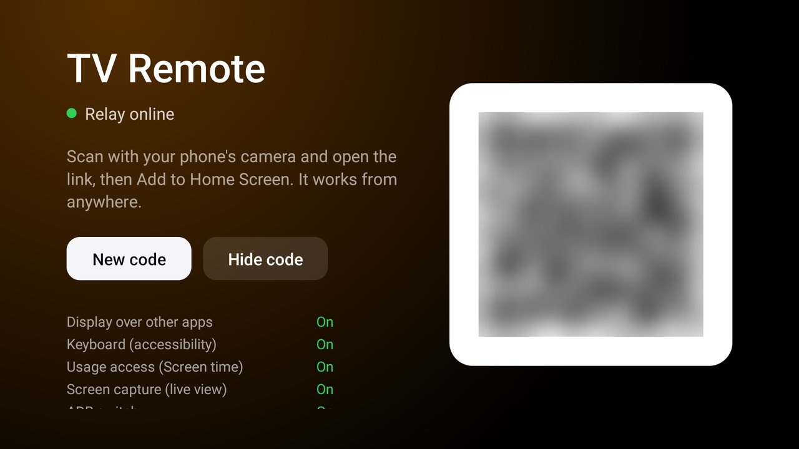

# TV Remote

A remote for the TV on your phone that works from anywhere, home or away, through a small relay you deploy
to your own Cloudflare account. There is no app to download on the phone: you scan a QR code on the TV and
get an installable web app (Add to Home Screen) with notifications. For the [Clean Your TV](../../README.md)
launcher it declares a [module card](../../docs/modules.md): once you answer **Show card** its tile reads
"TV Remote" with an orange glow. On any other Android TV home it is an ordinary app.

It comes from the launcher fork [github.com/ptrinh/tvhome-remote](https://github.com/ptrinh/tvhome-remote),
where the remote is built into Home. This add-on is the same remote as a separate app, with no change to the
launcher, and it uses the same relay and phone page.



## What the phone can do

| On the phone | What happens on the TV |
|---|---|
| **Live control** | A live view of the screen (about 2 pictures a second, 640 px wide), the D-pad with OK (hold it for the long press), Back, Home and Menu, volume, mute and channel up/down, and a keyboard that types into the text field selected on the TV. |
| **Message** | Your text, large in the middle of the screen over whatever is playing, until someone presses OK or Back (or you clear it). |
| **Lock** | "This TV is locked" with a PIN pad. It comes back to the front if someone leaves it with Home, and after a reboot. The PIN unlocks, or Unlock on the phone. |
| **Lock timer** | Locks the TV after 1 to 720 minutes, with a countdown in a small pill in the corner of the screen. |
| **Screen time** | Time per app for the last 24 hours or 7 days, from Android's usage events (only while the screen was on). |
| **Power** | Screen off and on (the TV keeps running), standby, and wake from standby (best effort). |
| **Notifications** | "TV is on" and "TV is off" on the phone, from the relay (Web Push; on iPhone only from the Home Screen app). |
| **Settings** | The PIN, the Sony IP control key (see below) and ADB over the network on or off, with the address to connect to. |

Behind those, the phone page can also open an app or a link on the TV, list the TV's apps, press any remote
button by name and call any Sony IP control method. The relay passes commands through by name, so new features
usually need only a new phone page; the full list is in [`relay/README.md`](relay/README.md).

### Sony IP control

The D-pad, every remote key (volume, mute, channel, Back, Home, Menu) and power use the TV's own IP control
(Sony BRAVIA): the keys are the remote's IRCC codes, so they work in every app. On the TV:

1. **Settings › Network & Internet › Remote device settings › Control remotely: On**
2. **Settings › Network & Internet › Home network › IP control › Authentication: Normal and Pre-Shared Key**,
   and set a Pre-Shared Key.

Then enter the same key in the phone page's Settings. The TV keeps it only once the TV accepts it ("Incorrect
key." otherwise), and then switches on Remote start (Wake-on-LAN) so the TV can be woken. Without a key the
keyboard, the live view, messages, the lock, Screen time and ADB still work, and standby uses Android's sleep
action through the accessibility service; the keys and the other power buttons say the key is missing.

## How it works

```text
 phone (web app) ──HTTPS──▶ relay: Cloudflare Worker + one Durable Object per TV ◀──WebSocket── TV Remote on the TV
                  ◀─status, notifications, live-view frames──┘                       (opened by the TV, never inbound)
```

The TV opens one WebSocket to your relay and keeps it open (a ping every 45 s; it reconnects with backoff, at
once when the screen comes on, and tells the relay when the screen goes off). The phone posts a command to the
relay, the relay checks the phone's key and hands the command to the TV, and the TV's answer goes back to the
phone. Nothing on your home network is opened to the internet. Sony IP control and ADB are reached by the TV
itself, on its own address.

On the TV, a foreground service (`RemoteService`, a minimal notification) holds the connection. It starts when
you open the card and at boot.

## Setup

You need a Cloudflare account (the free plan is fine), and JDK 17 with Android SDK platform 34 to build, as for
the launcher.

1. **Deploy the relay** to your Cloudflare account. The quick way, no Node.js needed:

   [](https://deploy.workers.cloudflare.com/?url=https://github.com/Gathin23/cleanyourtv/tree/main/addons/tv-remote/relay)

   or from a terminal:

   ```bash
   cd addons/tv-remote/relay
   npx wrangler login
   npx wrangler deploy        # prints https://tv-remote.<your-subdomain>.workers.dev
   ```

   Either way, note the address it gives you. Notifications work out of the box: the relay makes its own VAPID
   keys the first time a phone switches them on (to bring your own, see [`relay/README.md`](relay/README.md)).
2. **Build the TV app**: `cd addons/tv-remote && ./gradlew assembleRelease` (Windows: `gradlew.bat
   assembleRelease`). The APK has no relay address in it, so one build works with any relay.
3. **Install** it with ADB on, from the repo root, giving it your relay's address:

   ```bash
   RELAY_URL=https://tv-remote.<your-subdomain>.workers.dev TV_HOST=<tv ip> addons/tv-remote/install.sh
   ```

   (Windows: `addons\tv-remote\install.ps1 -TvHost <tv ip> -RelayUrl https://tv-remote.<your-subdomain>.workers.dev`.)
   It installs the APK (building it first if needed), saves the relay's address on the TV and grants what the
   features need, saying what each is for (see Permissions). To move to another relay later, run it again with
   the new address; no rebuild. (`./gradlew assembleRelease -PrelayUrl=…` still builds the address in, as a
   default the script can override.)
4. **Open the card** on the TV. It shows the QR code, whether the relay is online, and what install.sh granted.
5. **Scan the QR code** with the phone's camera and open the link.
6. **Add to Home Screen** (Safari: Share › Add to Home Screen; Chrome: Install app). On iPhone, notifications
   work only from the Home Screen app.

**New code** on the card makes a new phone key: every phone paired before stops working until it scans again.
**Hide code** hides the QR code while guests are watching; showing it again asks for the PIN, once you set one
from the phone. Press Home and answer **Show card** for the card; change the answer later by holding OK on
Settings, then Module cards.

The JVM tests (PIN hashing, the QR encoder against segno, Screen time's counting, the relay address check) run
with `./gradlew testReleaseUnitTest`. The release build is signed with the debug key so
it installs over ADB like the launcher. Uninstall with `TV_HOST=<tv ip> addons/tv-remote/install.sh --uninstall`.

## Permissions

| Permission | Why |
|---|---|
| Internet (`INTERNET`) | The WebSocket to your relay, and Sony IP control on the TV's own address (127.0.0.1 or its LAN address). Nothing else is contacted. |
| Foreground service (`FOREGROUND_SERVICE`, `FOREGROUND_SERVICE_SPECIAL_USE`) | `RemoteService` keeps the relay connection, the lock and the lock timer alive while other apps are in front. Its notification is at the lowest importance. |
| Foreground service, media projection (`FOREGROUND_SERVICE_MEDIA_PROJECTION`) | `LiveService` holds the screen capture for the live view. It runs only while a paired phone has the live view open and stops 3 s after the last one closes it. |
| Start at boot (`RECEIVE_BOOT_COMPLETED`) | To connect again after a reboot or an update, and to put the lock screen back if the TV was locked. |
| Display over other apps (`SYSTEM_ALERT_WINDOW`) | The lock timer's countdown pill (`TYPE_APPLICATION_OVERLAY`), and opening the message, the lock screen and the screen-capture request while another app is in front (Android only lets an app start screens from the background with this). Granted by install.sh, since many TVs hide the setting. Without it the timer shows a toast instead and messages and the lock may not come to the front. |
| Screen capture without a prompt (`PROJECT_MEDIA` app-op) | The live view. Granted by install.sh (`appops set io.github.ptrinh.tvremote PROJECT_MEDIA allow`); without it the TV shows Android's capture prompt each time. DRM video, HDMI inputs and the tuner come out black: Android keeps secure layers out of every capture. |
| Usage access (`PACKAGE_USAGE_STATS`, `GET_USAGE_STATS` app-op) | Screen time: which app was in front while the screen was on. Granted by install.sh (`appops set … GET_USAGE_STATS allow`). |
| Write secure settings (`WRITE_SECURE_SETTINGS`) | ADB over the network on or off from the phone's Settings. Granted by install.sh (`pm grant`); never asked for on the TV. |
| Accessibility service ("TV Remote keyboard") | Typing from the phone into the selected text field (ACTION_SET_TEXT, in any window), Back, Home, Recents, notifications and quick settings, and standby when there is no IP control key (Android's lock-screen action). No event types and no key filtering: the system never calls into it on its own, and it reads the windows only to find the text field when the phone types. Enabled by install.sh. |

No `POST_NOTIFICATIONS`: the service's notification is the only one, and Android shows it in the TV's
notification settings either way. The notifications on the phone come from your relay, not from the TV. The
app also lists the TV's apps (package visibility for launcher apps and web links) for the phone's app list,
launch command and Screen time names.

## Privacy

- **Your relay, your account.** The relay runs on your Cloudflare account; nothing goes to the add-on's author
  or anyone else. No telemetry, no ads, no accounts, no libraries in the APK.
- **The relay stores only hashes** of the TV key and the phone keys, the phones' push subscriptions, the TV's
  name, its power and lock state and when it was last seen. Commands and answers pass through without being
  stored. Invocation logs are off, since the manifest URL carries the phone key.
- **Live view only while a paired phone watches.** Frames go to the phones that have the live view open, never
  stored, and the capture stops 3 s after the last one leaves (Android's capture icon goes too).
- **The PIN** is kept on the TV as a salted SHA-256, in the app's private storage (backups are off). The Sony
  key is kept there too and is sent only to the TV itself.
- Anyone with the phone link can control the TV: treat it like a key. **New code** revokes every phone.

## Limits

- **Wake from standby is best effort.** In standby the TV usually stops the app's connection; with IP control
  and Remote start on, the TV may still answer wake.
- **Some apps draw their own keyboard**, which can't be typed into from outside; the phone says so.
- **Home leaves the lock screen** for a moment (Android doesn't let an app catch Home); it comes back within
  about 1.5 s while the TV is locked. Pulling the power or uninstalling the app over ADB ends the lock.
- **Aggressive memory managers** on 1 GB TVs may stop the service; opening the card starts it again.
- **The keys and power need Sony IP control**, so on TVs other than Sony BRAVIA the phone page's D-pad and
  volume don't work; the keyboard, messages, the lock, the live view and Screen time do. (The page's `global`
  building block, through the accessibility service, is where Back and Home for other TVs would go.)

## Tested on

Sony BRAVIA 4K AE2 (Google TV 14), the TV the remote was built and used on in the launcher fork. The add-on
is a port of that code; as an add-on it is still to be checked on that TV (and the screenshot taken there):

1. The card prompt and **Show card**; the card opens the QR screen; the relay shows online; a phone pairs.
2. A message and the lock come to the front over a streaming app; the lock comes back after Home and after a
   reboot; the lock timer's pill counts down and locks.
3. The live view starts without a prompt and stops 3 s after the phone closes it.
4. Screen time, the keyboard in a search field, Back/Home, ADB on/off, set_psk with a wrong and a right key,
   standby and wake.

## Maintainer

[@ptrinh](https://github.com/ptrinh)
